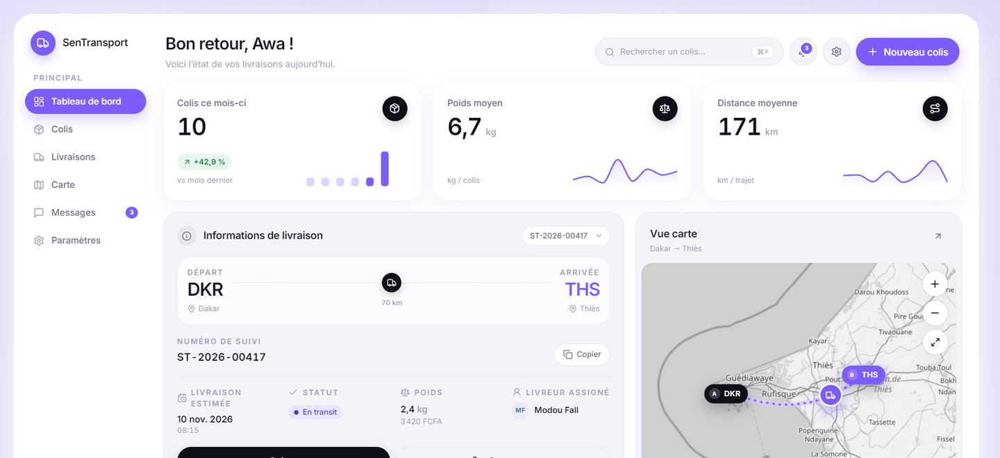
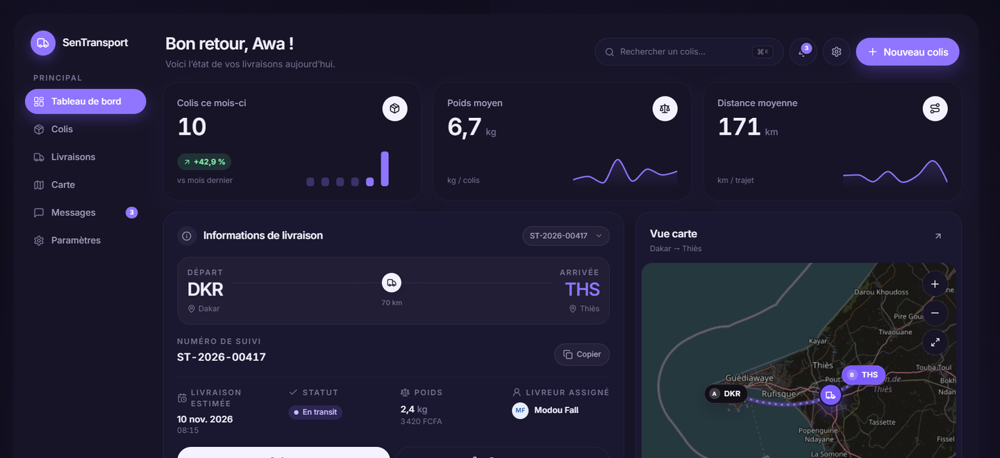

# SenTransport — Frontend

Tableau de bord de suivi de colis et de livraisons pour le réseau sénégalais
**SenTransport**. Application React mono-page (SPA) avec authentification, rôles,
mode démonstration sans backend et thème clair/sombre.


## Aperçu

| Tableau de bord — clair | Tableau de bord — sombre |
| --- | --- |
|  |  |

## Sommaire

- [Fonctionnalités](#fonctionnalités)
- [Stack technique](#stack-technique)
- [Démarrage rapide](#démarrage-rapide)
- [Comptes de démonstration](#comptes-de-démonstration)
- [Variables d'environnement](#variables-denvironnement)
- [Scripts](#scripts)
- [Structure du projet](#structure-du-projet)
- [Contrat d'API](#contrat-dapi)
- [Authentification et rôles](#authentification-et-rôles)
- [Mode démonstration (MSW)](#mode-démonstration-msw)
- [Tests et couverture](#tests-et-couverture)
- [Docker](#docker)
- [Déploiement derrière la passerelle Nginx](#déploiement-derrière-la-passerelle-nginx)
- [Scénario de démonstration](#scénario-de-démonstration)
- [Accessibilité et performance](#accessibilité-et-performance)
- [Limites connues](#limites-connues)

## Fonctionnalités

- **Authentification** : connexion, inscription, session JWT (mémoire +
  `sessionStorage`), déconnexion automatique sur `401` avec retour à la page
  demandée (`/login?redirect=…`).
- **Rôles** : `client`, `livreur`, `administrateur`. Navigation, actions et routes
  protégées s'adaptent au rôle ; une route interdite renvoie vers `/403`.
- **Tableau de bord** : KPI du mois, colis vedette (frise, destinataire,
  informations de livraison), jauge de ponctualité, carte du trajet en cours,
  fiche véhicule/livreur. Grille bento responsive.
- **Colis** : recherche plein texte (numéro, destinataire, ville), filtre par
  statut, tri, sélection multiple, export CSV, vues tableau et cartes,
  pagination, squelettes de chargement.
- **Création de colis** : parcours en 4 étapes (expéditeur, destinataire,
  description et poids, récapitulatif), validation Zod, estimation tarifaire,
  génération du bordereau.
- **Détail d'un colis** : frise verticale d'historique, informations, édition,
  suppression avec confirmation, bordereau imprimable avec QR code.
- **Livraisons** : vue liste et Kanban, affectation, statuts.
- **Espace livreur** : tournées du jour, passage en transit, livraison, échec
  avec motif, carte de tournée.
- **Carte réseau** : tuiles OpenStreetMap, marqueurs en pilules, regroupement par
  ville d'arrivée, filtres par statut.
- **Administration** : KPI, volume quotidien et répartition par statut (Recharts),
  gestion des utilisateurs, affectation des colis.
- **Suivi public** : `/suivi/:numero`, accessible sans compte.
- **Confort** : thème clair/sombre mémorisé, palette de commandes `Ctrl/⌘ + K`,
  centre de notifications, toasts, états vides et d'erreur, `ErrorBoundary`,
  pages 404/403.
- **Qualité** : TypeScript strict, aucun `any`, ESLint + Prettier, tests
  Vitest/RTL/MSW, images Docker multi-étapes, en-têtes de sécurité Nginx.

## Stack technique

| Domaine | Choix |
| --- | --- |
| UI | React 18, TypeScript 5.6, Vite 5 |
| Style | Tailwind CSS 3 (tokens CSS), composants maison |
| Routage | React Router 6 |
| Données | TanStack Query 5, Axios (intercepteurs JWT et 401) |
| État global | Zustand (session, thème, langue, notifications) |
| Formulaires | React Hook Form + Zod |
| Graphiques | Recharts, mini-graphiques SVG maison |
| Cartographie | Leaflet + React Leaflet, tuiles OpenStreetMap |
| Animations | Framer Motion (respecte `prefers-reduced-motion`) |
| Icônes / toasts | lucide-react, sonner |
| Tests | Vitest, Testing Library, MSW |
| Conteneur | Node 20 Alpine → Nginx 1.27 Alpine |

## Démarrage rapide

Prérequis : Node.js **20+** et npm 10+.

```bash
npm ci
cp .env.example .env
npm run dev
```

L'application écoute sur <http://localhost:5173>. Avec la configuration par
défaut (`VITE_USE_MOCKS=true`), MSW intercepte les appels : aucun backend n'est
nécessaire.

## Comptes de démonstration

Mot de passe commun : `Demo1234!`

| Rôle | E-mail | Accès principaux |
| --- | --- | --- |
| Client | `awa.diop@sentransport.sn` | Dashboard, colis, livraisons, carte, messages |
| Livreur | `modou.fall@sentransport.sn` | Mes tournées, carte, messages |
| Administrateur | `admin@sentransport.sn` | Tout, dont l'administration |

Les comptes ne sont affichés dans le formulaire que lorsque les mocks sont
actifs. Un clic sur un compte préremplit l'e-mail et le mot de passe.

## Variables d'environnement

Copier `.env.example` vers `.env` (fichier ignoré par Git).

| Variable | Défaut | Description |
| --- | --- | --- |
| `VITE_API_BASE_URL` | `/api` | Base relative de l'API, servie par la passerelle Nginx. |
| `VITE_API_TIMEOUT` | `15000` | Délai maximal d'une requête Axios (ms). |
| `VITE_USE_MOCKS` | `true` | `true` : MSW intercepte l'API ; `false` : appels réels. |
| `VITE_API_PROXY_TARGET` | — | Cible du proxy Vite en développement (ex. `http://localhost:8080`). |

Aucun secret n'est stocké dans le code. Le jeton vit en mémoire et dans
`sessionStorage` ; il n'est jamais écrit en clair dans le dépôt.

## Scripts

| Commande | Rôle |
| --- | --- |
| `npm run dev` | Serveur Vite avec HMR. |
| `npm run build` | Vérification TypeScript puis build de production dans `dist/`. |
| `npm run preview` | Prévisualisation du build. |
| `npm run lint` | ESLint, zéro avertissement toléré. |
| `npm run format` | Formatage Prettier de `src/`. |
| `npm run test` | Tests Vitest en mode CI. |
| `npm run test:watch` | Tests en surveillance. |
| `npm run test:coverage` | Tests + rapport de couverture (`coverage/`). |

## Structure du projet

```text
.
├── docs/screenshots/          # Captures utilisées par ce README
├── public/                    # Favicon, service worker MSW
├── src/
│   ├── api/                   # Client Axios, types, hooks par ressource
│   ├── components/
│   │   ├── dashboard/         # Cartes du bento (KPI, carte, jauge…)
│   │   ├── ui/                # Design system (Button, Card, Modal…)
│   │   └── CommandPalette.tsx
│   ├── features/              # Logique par domaine (auth, colis, carte)
│   ├── hooks/                 # useI18n, useCountUp, useMediaQuery
│   ├── layouts/               # AppShell, Sidebar, Header, AuthLayout…
│   ├── lib/                   # Formatage, constantes, CSV, i18n
│   ├── mocks/                 # Données sénégalaises et handlers MSW
│   ├── pages/                 # Une page par route
│   ├── store/                 # Zustand : auth et préférences UI
│   ├── styles/globals.css     # Tokens clair/sombre, Leaflet, impression
│   └── tests/                 # Setup Vitest, serveur MSW, helpers
├── Dockerfile
├── nginx.conf
├── tailwind.config.ts
└── vite.config.ts
```

## Contrat d'API

Toutes les requêtes passent par la passerelle, avec une base relative `/api`.
Le jeton est ajouté automatiquement : `Authorization: Bearer <jwt>`.

| Méthode | Route | Description |
| --- | --- | --- |
| `POST` | `/api/users/login` | Connexion, renvoie `{ token, utilisateur }`. |
| `POST` | `/api/users/register` | Inscription. |
| `GET` | `/api/users` | Liste des utilisateurs (filtre `role`). |
| `GET` | `/api/users/me` | Profil courant. |
| `PATCH` | `/api/users/me` | Mise à jour du profil. |
| `PATCH` | `/api/users/me/password` | Changement de mot de passe. |
| `PATCH` | `/api/users/:id` | Activation/désactivation (admin). |
| `GET` | `/api/colis` | Liste paginée (`page`, `limit`, `statut`, `ville`, `recherche`, `tri`). |
| `POST` | `/api/colis` | Création d'un colis. |
| `GET` | `/api/colis/:id` | Détail par identifiant ou numéro de suivi. |
| `PATCH` | `/api/colis/:id` | Mise à jour. |
| `DELETE` | `/api/colis/:id` | Suppression. |
| `GET` | `/api/colis/suivi/:numero` | Suivi public, sans authentification. |
| `GET` | `/api/livraisons` | Livraisons, filtre `livreurId`. |
| `PATCH` | `/api/livraisons/:id` | Statut de livraison. |

Les erreurs sont normalisées (`ApiError`) : message lisible, `status`, `code` et
`details` pour les erreurs de validation. Les timeouts et pertes réseau
produisent un message dédié.

## Authentification et rôles

1. `LoginForm` valide la saisie (Zod) puis appelle `POST /api/users/login`.
2. Le jeton et l'utilisateur sont stockés dans le store Zustand persisté en
   `sessionStorage` (`st.session`).
3. L'intercepteur Axios ajoute le Bearer à chaque requête.
4. Sur `401` hors routes publiques (`login`, `register`, `suivi`), la session est
   vidée et l'application redirige vers `/login?redirect=<page courante>`.
5. `ProtectedRoute` vérifie la session puis le rôle ; `403` si le rôle ne
   correspond pas.

## Mode démonstration (MSW)

`VITE_USE_MOCKS=true` active un service worker MSW chargé avant le rendu.

- Base en mémoire réinitialisée à chaque rechargement.
- 23 colis, 7 utilisateurs, livraisons et tournées répartis sur tout le Sénégal.
- Latence simulée : 220 ms en lecture, 380 ms en écriture.
- Cloisonnement par rôle : un client ne voit que ses colis, un livreur que ses
  livraisons.
- Endpoint public de suivi par numéro.

Pour désactiver les mocks : `VITE_USE_MOCKS=false` dans `.env`, puis
`VITE_API_PROXY_TARGET=http://localhost:8080` en développement pour atteindre la
passerelle.

## Tests et couverture

```bash
npm run test
npm run test:coverage
```

**10 fichiers, 40 tests** couvrant :

- `LoginForm` : validation, comptes de démonstration, connexion réussie, erreur
  API.
- `ColisTable` : rendu, tri, sélection unitaire et globale, en-tête indéterminé.
- `KpiCard` : valeur, unité, variations positive et négative, légende, résumé
  accessible du graphique.
- `OrderInfo` : trajet, suivi, livreur, changement de colis, copie du numéro.
- `ProtectedRoute` : redirection avec destination, accès autorisé, refus par rôle.
- Intercepteur `401` : déconnexion et redirection, exemption des routes publiques.
- Calculs du dashboard, schémas Zod, export CSV (échappement et BOM UTF-8).
- `parcours.test.tsx` : intégration des pages avec MSW et le shell complet —
  dashboard, notifications, palette `Ctrl+K`, liste et création de colis en quatre
  étapes, détail et modales, livraisons liste/Kanban, carte réseau filtrable,
  messages, paramètres, tournées livreur, administration, suivi public,
  inscription, 404/403 et erreur globale, montage de l’application complète.

Couverture mesurée sur l'ensemble de `src/` : **86,36 % des lignes**, 75,64 % des
branches, 60,94 % des fonctions. Les seuils du projet (80/70/55) verrouillent ce
niveau comme plancher de non-régression. Les pages sont désormais exercées par la
suite d'intégration ; la recette manuelle décrite plus bas reste utile pour le
rendu visuel et le responsive réels.

## Docker

Build de démonstration (mocks activés) :

```bash
docker build --build-arg VITE_USE_MOCKS=true -t sentransport-frontend .
docker run --rm -p 8080:80 sentransport-frontend
```

L'application est servie sur <http://localhost:8080>. La sonde
`GET /healthz` renvoie `200 ok` et alimente le `HEALTHCHECK` Docker.

Build branché sur la passerelle (mocks désactivés) :

```bash
docker build \
  --build-arg VITE_USE_MOCKS=false \
  --build-arg VITE_API_BASE_URL=/api \
  -t sentransport-frontend .
```

L'image finale ne contient que le build statique et Nginx : pas de Node, pas de
`node_modules`, pas de secrets. `nginx.conf` fournit le fallback SPA
(`try_files $uri $uri/ /index.html`), le cache long des assets fingerprintés et
les en-têtes `X-Content-Type-Options`, `X-Frame-Options` et `Referrer-Policy`.

## Déploiement derrière la passerelle Nginx

Le frontend appelle uniquement `/api`. La passerelle doit proxyfier ce préfixe
vers l'API métier, sans exposer de secret au navigateur :

```nginx
location /api/ {
    proxy_pass http://api-sentransport:8080/;
    proxy_set_header Host $host;
    proxy_set_header X-Forwarded-For $proxy_add_x_forwarded_for;
    proxy_set_header X-Forwarded-Proto $scheme;
}
```

Servir ensuite le contenu de `dist/` (ou l'image ci-dessus) sur le même origine
que `/api` pour éviter toute configuration CORS.

## Scénario de démonstration

1. Ouvrir <http://localhost:5173>, cliquer sur **Awa Diop** puis **Se connecter**.
2. Sur le tableau de bord, vérifier le colis `ST-2026-00417` (Dakar → Thiès),
   sa frise et la carte du trajet. Changer de colis via le sélecteur.
3. Passer en thème sombre depuis la barre latérale ou les paramètres ; recharger
   la page : la préférence est conservée.
4. Ouvrir **Colis**, rechercher `Mariama`, filtrer sur « En transit », trier par
   poids, sélectionner deux lignes et exporter le CSV.
5. Ouvrir **Nouveau colis** et dérouler les quatre étapes ; à la fin, le
   bordereau est imprimable (le QR code encode le numéro de suivi).
6. Se déconnecter, se connecter en **Modou Fall** (livreur) : passer une course
   en transit, puis la marquer livrée. Tester un échec avec motif.
7. Se reconnecter en **Abdoulaye Mbaye** (admin) : consulter les graphiques,
   affecter un colis sans livreur, désactiver puis réactiver un compte.
8. Ouvrir `/suivi/ST-2026-00417` dans un onglet privé : le suivi public
   fonctionne sans session.

## Accessibilité et performance

- Contrastes AA sur les textes et les états interactifs ; focus visible sur tous
  les contrôles.
- Navigation clavier complète, palette `Ctrl/⌘ + K`, fermeture des modales avec
  `Échap`, libellés ARIA sur les icônes et les graphiques.
- `prefers-reduced-motion` désactive les animations et les compteurs.
- Chunks séparés pour Leaflet, Recharts et Framer Motion ; assets fingerprintés
  servis avec un cache immuable.
- Images et icônes légères (lucide-react, SVG inline), pas de police distante
  autre qu'Inter via Google Fonts.

## Limites connues

- Les mocks MSW vivent en mémoire : les créations et modifications sont perdues
  au rechargement.
- Sans backend, l'export CSV et l'impression sont fonctionnels mais les données
  restent locales au navigateur.
- Les tuiles OpenStreetMap sont utilisées pour la démonstration ; pour un trafic
  soutenu, prévoir un fournisseur de tuiles contractuel.
- Les tests d'intégration utilisent jsdom : Leaflet y est simulé, le rendu
  cartographique réel et le responsive restent vérifiés manuellement.
